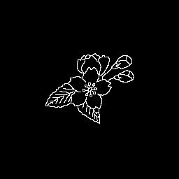
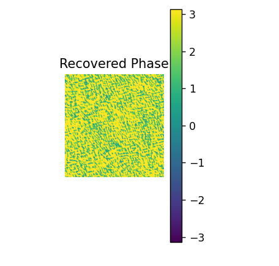
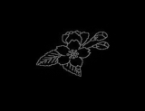
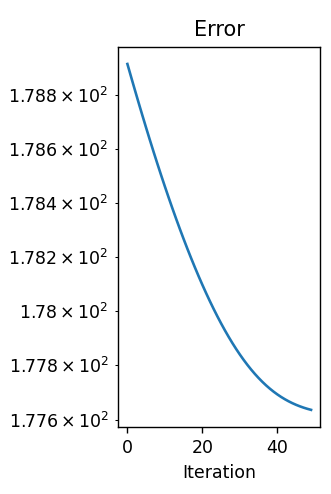
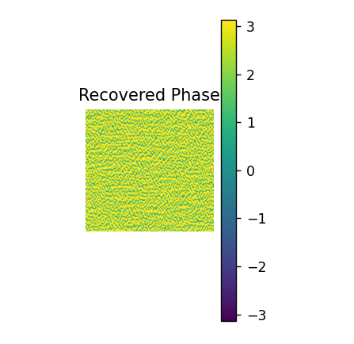
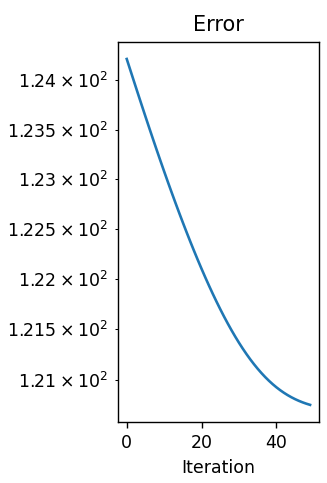
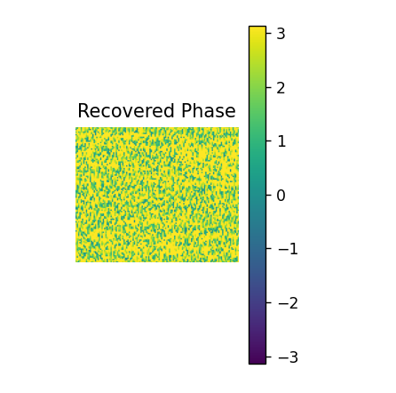

#  Autodiff Phase Retrieval for Computer-Generated Holography

This project implements a **phase retrieval algorithm** using **automatic differentiation** and **gradient descent** in PyTorch. The goal is to generate a phase pattern for a **Spatial Light Modulator (SLM)** that reconstructs a target intensity image through Fourier optics for **computer generated holography**.

---

##  Overview

Phase retrieval is a fundamental problem in computational holography. Given a target image (intensity), the algorithm estimates the phase pattern that, when combined with a known amplitude and passed through an optical system (Fourier Transform), reconstructs the desired image.

This project:
- Loads a grayscale target image.
- Initializes a random phase and fixed amplitude.
- Optimizes the phase using **PyTorch autograd** and the **ADAM optimizer**.
- Saves the recovered phase pattern to an `.h5` file.

---

##  How It Works

### 1. Target Image
The user provides a grayscale image (e.g., `sakura.jpg`) that serves as the target intensity in the reconstruction plane. The image is resized to match the SLM dimensions (1280×1024).

### 2. Initialization
A random phase is generated, and the amplitude is set uniformly.

### 3. Optimization
The forward model uses a Fourier transform to simulate the optical propagation:
- Complex field at the SLM: u = A · exp(i·φ)
- Image plane: U = |F(u)|

The loss function minimizes the difference between the simulated amplitude and the target:
```python
loss = torch.sqrt(torch.sum((U - targetA)**2))
```

### Example Outputs

| Target Intensity | Recovered Phase | Reconstructed Intensity | Error Curve | Holography |
|------------------|------------------|--------------------------|-------------|-------------|
|  |  |  |  |
|  |  |  |  |
|  |  |  |  |

---

### Requirements

- Python 3.8+
- [PyTorch](https://pytorch.org)
- [NumPy](https://numpy.org/doc/stable/index.html)
- [Matplotlib](https://matplotlib.org/stable/users/index)
- [Pillow (PIL)](https://pypi.org/project/pillow/)
- [h5py](https://www.h5py.org/)

## References

- Goodman, J. W. _Introduction to Fourier Optics_
- [PyTorch Autograd Documentation](https://pytorch.org/docs/stable/autograd.html)
-  Wong, A., Pope, B., Desdoigts, L., Tuthill, P., Norris, B., & Betters, C.  
  **[Phase Retrieval and Design with Automatic Differentiation](https://arxiv.org/pdf/2107.00952)**  
  *Sydney Institute for Astronomy (SIfA), School of Physics, The University of Sydney; University of Queensland; University of Southern Queensland*  
  [a.wong@sydney.edu.au](mailto:a.wong@sydney.edu.au)
- Dong, J., Valzania, L., Maillard, A., & Thanh  
  **[Phase Retrieval: From Computational Imaging to Machine Learning](https://ieeexplore.ieee.org/stamp/stamp.jsp?tp=&arnumber=10004797)**
- Wang, K., Song, L., Wang, C., Ren, Z., Zhao, G., Dou, J., Di, J., Barbastathis, G., Zhou, R., Zhao, J., & Lam, E. Y.  
  **[On the Use of Deep Learning for Phase Recovery](https://www.nature.com/articles/s41377-023-01340-x)**  
  Affiliations: Shanghai Jiao Tong University; University of Science and Technology of China; MIT
- Madsen, A. E. G., Eriksen, R. L., & Glückstad, J.  
  **[Comparison of State-of-the-Art Computer Generated Holography Algorithms and a Machine Learning Approach](https://www.sciencedirect.com/science/article/pii/S0030401821008397?ref=pdf_download&fr=RR-2&rr=95ff9f872bef3a95)**  
- Di Leonardo, R., Ianni, F., & Ruocco, G.  
  **Computer Generation of Optimal Holograms for Optical Trap Arrays**  
  *Optics Express*, **15**, 1913–1922 (2007)  
  [DOI:10.1364/OE.15.001913](https://doi.org/10.1364/OE.15.001913)

---

## Author

Developed by **[Carlos Broch](https://github.com/CBROCHC)** with the support of the optics and photonics research group [GROC](https://www.groc.uji.es/), as an experimental implementation of autodiff techniques for phase retrieval in computer-generated holography.
